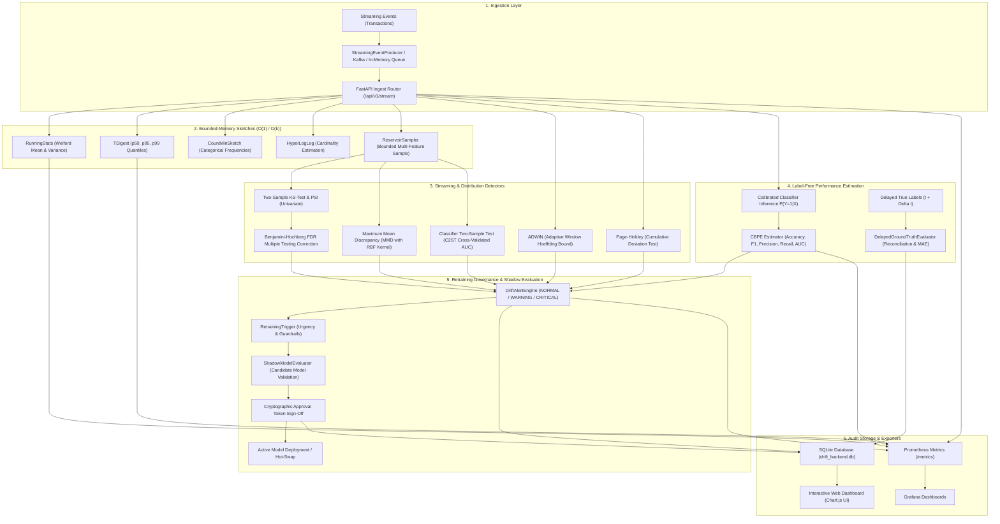

# Repository Index & Architecture Catalog

## Label-Free Streaming Drift Monitor with Bounded-Memory Sketches and Automated Retrain Triggers

This document provides a comprehensive, structured index of all source files, modules, mathematical algorithms, data structures, REST endpoints, database schemas, and test suites across the repository.

---

## Table of Contents

1. [System Architecture Overview](#1-system-architecture-overview)
2. [File & Directory Manifest](#2-file--directory-manifest)
3. [Component & Algorithm Catalog](#3-component--algorithm-catalog)
   - [3.1 Bounded-Memory Streaming Sketches (`ml_engine/drift_monitor/sketches/`)](#31-bounded-memory-streaming-sketches)
   - [3.2 Streaming & Windowed Drift Detectors (`ml_engine/drift_monitor/detectors/`)](#32-streaming--windowed-drift-detectors)
   - [3.3 Label-Free Performance Estimation (`ml_engine/drift_monitor/performance_estimation/`)](#33-label-free-performance-estimation)
   - [3.4 Retraining Triggers & Shadow Governance (`ml_engine/drift_monitor/retraining/`)](#34-retraining-triggers--shadow-governance)
   - [3.5 Master Streaming Engine (`ml_engine/drift_monitor/monitor.py`)](#35-master-streaming-engine)
   - [3.6 Synthetic Benchmarks & Evaluation (`ml_engine/drift_monitor/benchmarks/`)](#36-synthetic-benchmarks--evaluation)
4. [Backend & Streaming Systems Catalog (`backend/app/`)](#4-backend--streaming-systems-catalog)
   - [4.1 API Endpoints & Routing Matrix](#41-api-endpoints--routing-matrix)
   - [4.2 Streaming Ingestion & Broker Integration (`backend/app/streaming/`)](#42-streaming-ingestion--broker-integration)
   - [4.3 Thread-Safe SQLite Persistence (`backend/app/storage/`)](#43-thread-safe-sqlite-persistence)
   - [4.4 Interactive Web Dashboard (`backend/app/dashboard/`)](#44-interactive-web-dashboard)
   - [4.5 Prometheus Metrics Catalog (`/metrics`)](#45-prometheus-metrics-catalog)
5. [Complete Test Suite Catalog (36 Tests)](#5-complete-test-suite-catalog-36-tests)
6. [Team Ownership & Role Matrix](#6-team-ownership--role-matrix)

---

## 1. System Architecture Overview

---

## 2. File & Directory Manifest

| File / Directory Path | Purpose / Description | Primary Owner |
| :--- | :--- | :---: |
| [`ml_engine/`](file:///c:/Users/navde/OneDrive/Desktop/Hiral/Interactive-Model-Studio/ml_engine) | Mathematical ML core, bounded sketches, detectors, CBPE, benchmarks | **Person 1 (Hiral)** |
| ├── [`drift_monitor/config.py`](file:///c:/Users/navde/OneDrive/Desktop/Hiral/Interactive-Model-Studio/ml_engine/drift_monitor/config.py) | Central dataclass configuration for windows, sketches, thresholds | Person 1 |
| ├── [`drift_monitor/dataset.py`](file:///c:/Users/navde/OneDrive/Desktop/Hiral/Interactive-Model-Studio/ml_engine/drift_monitor/dataset.py) | `StreamingFinancialBenchmark` & Elliptic Bitcoin dataset loader | Person 1 |
| ├── [`drift_monitor/model.py`](file:///c:/Users/navde/OneDrive/Desktop/Hiral/Interactive-Model-Studio/ml_engine/drift_monitor/model.py) | `BaselineModelWrapper` with Platt/Sigmoid probability calibration | Person 1 |
| ├── [`drift_monitor/monitor.py`](file:///c:/Users/navde/OneDrive/Desktop/Hiral/Interactive-Model-Studio/ml_engine/drift_monitor/monitor.py) | Master `StreamingDriftMonitor` orchestrating sketches, tests, CBPE | Person 1 |
| ├── `drift_monitor/sketches/` | Bounded-memory statistical summaries | Person 1 |
| │   ├── [`running_stats.py`](file:///c:/Users/navde/OneDrive/Desktop/Hiral/Interactive-Model-Studio/ml_engine/drift_monitor/sketches/running_stats.py) | Welford algorithm for running mean, variance, std dev ($O(1)$) | Person 1 |
| │   ├── [`tdigest.py`](file:///c:/Users/navde/OneDrive/Desktop/Hiral/Interactive-Model-Studio/ml_engine/drift_monitor/sketches/tdigest.py) | Ted Dunning t-digest approximate quantile sketch | Person 1 |
| │   ├── [`count_min_sketch.py`](file:///c:/Users/navde/OneDrive/Desktop/Hiral/Interactive-Model-Studio/ml_engine/drift_monitor/sketches/count_min_sketch.py) | Count-Min Sketch with conservative update | Person 1 |
| │   ├── [`hyperloglog.py`](file:///c:/Users/navde/OneDrive/Desktop/Hiral/Interactive-Model-Studio/ml_engine/drift_monitor/sketches/hyperloglog.py) | HyperLogLog approximate cardinality estimator ($64$ registers) | Person 1 |
| │   └── [`reservoir.py`](file:///c:/Users/navde/OneDrive/Desktop/Hiral/Interactive-Model-Studio/ml_engine/drift_monitor/sketches/reservoir.py) | Algorithm R fixed-capacity reservoir sampler ($K=500$) | Person 1 |
| ├── `drift_monitor/detectors/` | Univariate and multivariate drift detection engines | Person 1 |
| │   ├── [`adwin.py`](file:///c:/Users/navde/OneDrive/Desktop/Hiral/Interactive-Model-Studio/ml_engine/drift_monitor/detectors/adwin.py) | ADWIN (Adaptive Windowing) with Hoeffding bounds | Person 1 |
| │   ├── [`page_hinkley.py`](file:///c:/Users/navde/OneDrive/Desktop/Hiral/Interactive-Model-Studio/ml_engine/drift_monitor/detectors/page_hinkley.py) | Page-Hinkley sequential change detector on cumulative mean | Person 1 |
| │   ├── [`distribution_tests.py`](file:///c:/Users/navde/OneDrive/Desktop/Hiral/Interactive-Model-Studio/ml_engine/drift_monitor/detectors/distribution_tests.py) | Two-sample Kolmogorov-Smirnov test and Population Stability Index | Person 1 |
| │   ├── [`mmd.py`](file:///c:/Users/navde/OneDrive/Desktop/Hiral/Interactive-Model-Studio/ml_engine/drift_monitor/detectors/mmd.py) | Maximum Mean Discrepancy (MMD) with Gaussian RBF kernel | Person 1 |
| │   ├── [`c2st.py`](file:///c:/Users/navde/OneDrive/Desktop/Hiral/Interactive-Model-Studio/ml_engine/drift_monitor/detectors/c2st.py) | Classifier Two-Sample Test (Domain discriminator ROC-AUC) | Person 1 |
| │   └── [`corrections.py`](file:///c:/Users/navde/OneDrive/Desktop/Hiral/Interactive-Model-Studio/ml_engine/drift_monitor/detectors/corrections.py) | Benjamini-Hochberg FDR & Bonferroni multiple testing adjustments | Person 1 |
| ├── `drift_monitor/performance_estimation/` | Label-free metrics estimation & delayed ground-truth reconciliation | Person 1 |
| │   ├── [`cbpe.py`](file:///c:/Users/navde/OneDrive/Desktop/Hiral/Interactive-Model-Studio/ml_engine/drift_monitor/performance_estimation/cbpe.py) | Confidence-Based Performance Estimation (Accuracy, F1, AUC, Brier) | Person 1 |
| │   └── [`delayed_evaluator.py`](file:///c:/Users/navde/OneDrive/Desktop/Hiral/Interactive-Model-Studio/ml_engine/drift_monitor/performance_estimation/delayed_evaluator.py) | Matching queue, actual metric calculation, and MAE/bias tracking | Person 1 |
| ├── `drift_monitor/retraining/` | Alerting, retrain triggers, and shadow model governance | Person 1 |
| │   ├── [`alert_engine.py`](file:///c:/Users/navde/OneDrive/Desktop/Hiral/Interactive-Model-Studio/ml_engine/drift_monitor/retraining/alert_engine.py) | Multi-signal severity classification (`NORMAL`, `WARNING`, `CRITICAL`) | Person 1 |
| │   ├── [`retrain_trigger.py`](file:///c:/Users/navde/OneDrive/Desktop/Hiral/Interactive-Model-Studio/ml_engine/drift_monitor/retraining/retrain_trigger.py) | Urgency determination (`LOW`, `MEDIUM`, `HIGH`) & guardrails | Person 1 |
| │   └── [`shadow_evaluator.py`](file:///c:/Users/navde/OneDrive/Desktop/Hiral/Interactive-Model-Studio/ml_engine/drift_monitor/retraining/shadow_evaluator.py) | Shadow model training, benchmark comparison, and approval token | Person 1 |
| ├── `drift_monitor/benchmarks/` | Synthetic drift benchmark generators and automated reports | Person 1 |
| │   ├── [`drift_generator.py`](file:///c:/Users/navde/OneDrive/Desktop/Hiral/Interactive-Model-Studio/ml_engine/drift_monitor/benchmarks/drift_generator.py) | Injects abrupt, gradual, recurring, and feature-specific drift | Person 1 |
| │   ├── [`run_benchmarks.py`](file:///c:/Users/navde/OneDrive/Desktop/Hiral/Interactive-Model-Studio/ml_engine/drift_monitor/benchmarks/run_benchmarks.py) | Automated execution harness for experimental benchmark evaluation | Person 1 |
| │   ├── [`generate_report.py`](file:///c:/Users/navde/OneDrive/Desktop/Hiral/Interactive-Model-Studio/ml_engine/drift_monitor/benchmarks/generate_report.py) | Produces Markdown and CSV reports with benchmark tables | Person 1 |
| │   └── `reports/` | Generated experimental artifacts (Markdown & CSV) | Person 1 |
| └── [`ml_engine/tests/`](file:///c:/Users/navde/OneDrive/Desktop/Hiral/Interactive-Model-Studio/ml_engine/tests) | 19 unit and integration tests for ML engine (100% passing) | Person 1 |
| [`backend/`](file:///c:/Users/navde/OneDrive/Desktop/Hiral/Interactive-Model-Studio/backend) | Streaming system, FastAPI services, SQLite, UI dashboard, tests | **Person 2 (Laxmi Singla)** |
| ├── [`app/config.py`](file:///c:/Users/navde/OneDrive/Desktop/Hiral/Interactive-Model-Studio/backend/app/config.py) | Server, Kafka/Redpanda connection, and storage settings | Person 2 |
| ├── [`app/main.py`](file:///c:/Users/navde/OneDrive/Desktop/Hiral/Interactive-Model-Studio/backend/app/main.py) | FastAPI app, CORS, lifespan, Prometheus exporter, and static mounting | Person 2 |
| ├── `app/schemas/` | Strongly-typed Pydantic schemas | Person 2 |
| │   ├── [`events.py`](file:///c:/Users/navde/OneDrive/Desktop/Hiral/Interactive-Model-Studio/backend/app/schemas/events.py) | `TransactionEvent`, `RecordIngestResponse`, `BatchIngestRequest` | Person 2 |
| │   ├── [`drift.py`](file:///c:/Users/navde/OneDrive/Desktop/Hiral/Interactive-Model-Studio/backend/app/schemas/drift.py) | `UnivariateFeatureMetrics`, `MultivariateDriftResponse`, `DriftStatusResponse` | Person 2 |
| │   ├── [`performance.py`](file:///c:/Users/navde/OneDrive/Desktop/Hiral/Interactive-Model-Studio/backend/app/schemas/performance.py) | `PerformanceEstimateResponse`, `DelayedLabelsRequest`, `DelayedReconciliationResponse` | Person 2 |
| │   └── [`alerts.py`](file:///c:/Users/navde/OneDrive/Desktop/Hiral/Interactive-Model-Studio/backend/app/schemas/alerts.py) | `AlertDetailResponse`, `CandidateEvaluationResponse`, `PromotionApprovalResponse` | Person 2 |
| ├── [`app/storage/database.py`](file:///c:/Users/navde/OneDrive/Desktop/Hiral/Interactive-Model-Studio/backend/app/storage/database.py) | Thread-safe SQLite manager (`drift_events`, `retrain_audits`, `performance_evaluations`) | Person 2 |
| ├── `app/services/` | Business logic services | Person 2 |
| │   ├── [`drift_service.py`](file:///c:/Users/navde/OneDrive/Desktop/Hiral/Interactive-Model-Studio/backend/app/services/drift_service.py) | Singleton service connecting monitor, benchmark, and storage | Person 2 |
| │   └── [`alert_service.py`](file:///c:/Users/navde/OneDrive/Desktop/Hiral/Interactive-Model-Studio/backend/app/services/alert_service.py) | Alert formatting and database historical queries | Person 2 |
| ├── `app/streaming/` | Streaming pipeline & broker connectors | Person 2 |
| │   ├── [`producer.py`](file:///c:/Users/navde/OneDrive/Desktop/Hiral/Interactive-Model-Studio/backend/app/streaming/producer.py) | `StreamingEventProducer` (Kafka + local traffic simulator) | Person 2 |
| │   └── [`consumer.py`](file:///c:/Users/navde/OneDrive/Desktop/Hiral/Interactive-Model-Studio/backend/app/streaming/consumer.py) | `StreamingEventConsumer` (Kafka worker + in-memory queue) | Person 2 |
| ├── `app/routers/` | FastAPI REST API routers | Person 2 |
| │   ├── [`stream.py`](file:///c:/Users/navde/OneDrive/Desktop/Hiral/Interactive-Model-Studio/backend/app/routers/stream.py) | `/record`, `/batch`, `/simulate` endpoints | Person 2 |
| │   ├── [`drift.py`](file:///c:/Users/navde/OneDrive/Desktop/Hiral/Interactive-Model-Studio/backend/app/routers/drift.py) | `/status`, `/univariate`, `/multivariate`, `/events` endpoints | Person 2 |
| │   ├── [`performance.py`](file:///c:/Users/navde/OneDrive/Desktop/Hiral/Interactive-Model-Studio/backend/app/routers/performance.py) | `/estimated`, `/labels`, `/history` endpoints | Person 2 |
| │   ├── [`alerts.py`](file:///c:/Users/navde/OneDrive/Desktop/Hiral/Interactive-Model-Studio/backend/app/routers/alerts.py) | `/active`, `/recommendation`, `/history` endpoints | Person 2 |
| │   ├── [`retrain.py`](file:///c:/Users/navde/OneDrive/Desktop/Hiral/Interactive-Model-Studio/backend/app/routers/retrain.py) | `/status`, `/evaluate-candidate`, `/approve` endpoints | Person 2 |
| │   └── [`benchmarks.py`](file:///c:/Users/navde/OneDrive/Desktop/Hiral/Interactive-Model-Studio/backend/app/routers/benchmarks.py) | `/results`, `/run` connected ML Engine benchmark endpoints | Joint |
| ├── `app/dashboard/static/` | Interactive Single-Page Application (SPA) Web Dashboard | Person 2 |
| │   ├── [`index.html`](file:///c:/Users/navde/OneDrive/Desktop/Hiral/Interactive-Model-Studio/backend/app/dashboard/static/index.html) | Responsive HTML5 layout with KPI cards, Chart.js views, and tabs | Person 2 |
| │   ├── [`styles.css`](file:///c:/Users/navde/OneDrive/Desktop/Hiral/Interactive-Model-Studio/backend/app/dashboard/static/styles.css) | Dark theme CSS with animated badges, tables, and modal panels | Person 2 |
| │   └── [`app.js`](file:///c:/Users/navde/OneDrive/Desktop/Hiral/Interactive-Model-Studio/backend/app/dashboard/static/app.js) | Client logic, live polling, Chart.js charts, and action triggers | Person 2 |
| ├── [`backend/tests/`](file:///c:/Users/navde/OneDrive/Desktop/Hiral/Interactive-Model-Studio/backend/tests) | 17 unit and integration tests for backend APIs and streaming (100% passing) | Person 2 |
| └── [`backend/requirements.txt`](file:///c:/Users/navde/OneDrive/Desktop/Hiral/Interactive-Model-Studio/backend/requirements.txt) | Pinned dependencies for FastAPI backend stack | Person 2 |
| [`tests/test_e2e_integration.py`](file:///c:/Users/navde/OneDrive/Desktop/Hiral/Interactive-Model-Studio/tests/test_e2e_integration.py) | 5 unified end-to-end integration tests connecting Person 1 + Person 2 | Joint |
| [`main.py`](file:///c:/Users/navde/OneDrive/Desktop/Hiral/Interactive-Model-Studio/main.py) | Unified Master CLI (`serve`, `demo`, `benchmark`, `test`) | Joint |
| [`Dockerfile`](file:///c:/Users/navde/OneDrive/Desktop/Hiral/Interactive-Model-Studio/Dockerfile) | Production multi-stage Docker build for backend and engine | Person 2 |
| [`docker-compose.yml`](file:///c:/Users/navde/OneDrive/Desktop/Hiral/Interactive-Model-Studio/docker-compose.yml) | Multi-container orchestration (Backend, Redpanda, Prometheus, Grafana) | Person 2 |
| [`prometheus.yml`](file:///c:/Users/navde/OneDrive/Desktop/Hiral/Interactive-Model-Studio/prometheus.yml) | Prometheus scraping configuration targeting `backend:8000/metrics` | Person 2 |
| [`run_person1_demo.py`](file:///c:/Users/navde/OneDrive/Desktop/Hiral/Interactive-Model-Studio/run_person1_demo.py) | Turn-by-turn verification showcase for Person 1 ML engine | Person 1 |
| [`run_person2_backend_demo.py`](file:///c:/Users/navde/OneDrive/Desktop/Hiral/Interactive-Model-Studio/run_person2_backend_demo.py) | Turn-by-turn verification showcase for Person 2 backend & systems | Person 2 |
| [`README.md`](file:///c:/Users/navde/OneDrive/Desktop/Hiral/Interactive-Model-Studio/README.md) | Primary project presentation, roadmap, architecture, and instructions | Joint |
| [`requirements.txt`](file:///c:/Users/navde/OneDrive/Desktop/Hiral/Interactive-Model-Studio/requirements.txt) | Core machine learning and numerical dependencies | Person 1 |
| [`INDEX.md`](file:///c:/Users/navde/OneDrive/Desktop/Hiral/Interactive-Model-Studio/INDEX.md) | This master architecture and file index catalog | Joint |

---

## 3. Component & Algorithm Catalog

### 3.1 Bounded-Memory Streaming Sketches

Compact, sub-linear data structures maintaining approximate statistics over high-throughput streams without storing raw historical tuples.

| Sketch Class | File | Space Complexity | Time Complexity | Mathematical Formulation | Monitored Signal |
| :--- | :--- | :---: | :---: | :--- | :--- |
| `RunningStats` | `running_stats.py` | $O(1)$ | $O(1)$ | **Welford's Algorithm**: $M_k = M_{k-1} + \frac{x_k - M_{k-1}}{k}$, $S_k = S_{k-1} + (x_k - M_{k-1})(x_k - M_k)$ | Stream Mean, Variance, Std Dev |
| `TDigest` | `tdigest.py` | $O(K)$ | $O(\log K)$ | **Ted Dunning Centroid Compression**: Non-linear scale function $\delta$ giving high accuracy at tails ($p01, p95, p99$) | Numerical Quantiles & Extremes |
| `CountMinSketch` | `count_min_sketch.py` | $O(w \times d)$ | $O(d)$ | **Conservative Update**: Increment only minimum-counter hash cells: $\hat{a}_{i} = \min_{j} C[j, h_j(i)]$ | Categorical Item Frequencies |
| `HyperLogLog` | `hyperloglog.py` | $O(m)$ ($64$ regs) | $O(1)$ | **Flajolet et al. Harmonic Mean**: $E = \alpha_m m^2 \left(\sum_{j=1}^m 2^{-M[j]}\right)^{-1}$ | Distinct Entity Cardinality |
| `ReservoirSampler` | `reservoir.py` | $O(K)$ | $O(1)$ | **Vitter's Algorithm R**: Replaces existing element with probability $K/n$ for true uniform sampling | Multi-Feature Sample Tuples |

### 3.2 Streaming & Windowed Drift Detectors

| Detector Class / Function | File | Type | Theoretical Foundation | Key Parameters |
| :--- | :--- | :---: | :--- | :--- |
| `ADWIN` | `adwin.py` | Streaming Change-Point | **Hoeffding Adaptive Window**: Compares sub-windows $W_0, W_1$. Splits if $|\hat{\mu}_0 - \hat{\mu}_1| \ge \epsilon_{cut} = \sqrt{\frac{1}{2m} \ln\frac{4n}{\delta}}$ | $\delta=0.002, R=1.0$ |
| `PageHinkley` | `page_hinkley.py` | Sequential Cumulative Sum | **Page-Hinkley CUSUM**: Tracks cumulative deviation $U_t = \sum (x_i - \bar{x} - \delta)$. Triggers when $U_t - \min(U) > \lambda$ | $\delta=0.05, \lambda=50.0, \alpha=0.999$ |
| `kolmogorov_smirnov_test` | `distribution_tests.py` | Non-Parametric Two-Sample | **Two-Sample KS**: $D = \sup_x |F_{\text{ref}}(x) - F_{\text{cur}}(x)|$ with asymptotic Kolmogorov distribution | $\alpha=0.05$ |
| `calculate_psi` | `distribution_tests.py` | Binned Divergence | **Population Stability Index**: $\text{PSI} = \sum (P_i - Q_i) \ln(P_i / Q_i)$ across reference quantiles | $n_{\text{bins}}=10, \epsilon=10^{-4}$ |
| `MaximumMeanDiscrepancy` | `mmd.py` | Multivariate Kernel RKHS | **MMD in RKHS**: $\text{MMD}^2(P, Q) = \mathbb{E}[k(X,X')] - 2\mathbb{E}[k(X,Y)] + \mathbb{E}[k(Y,Y')]$ with Permutation test | Kernel: RBF (median heuristic), Permutations: $100$ |
| `ClassifierTwoSampleTest` | `c2st.py` | Multivariate Domain Classif. | **C2ST**: Trains LightGBM/GBDT discriminator to separate Ref ($Y=0$) from Stream ($Y=1$). Tests if $\text{AUC} > 0.5$ | 3-fold CV, $\alpha=0.05, \text{AUC}_{\text{threshold}}=0.65$ |
| `benjamini_hochberg_correction` | `corrections.py` | Multiple Testing Correction | **False Discovery Rate (FDR)**: Rejects $H_{(i)}$ if $p_{(i)} \le \frac{i}{m} Q$, strictly controlling false alarms | $Q=0.05$ |

### 3.3 Label-Free Performance Estimation

| Component | File | Description | Core Formulations |
| :--- | :--- | :--- | :--- |
| `ConfidenceBasedPerformanceEstimator` | `cbpe.py` | Estimates classification metrics without labels using calibrated probabilities $p(x) \approx P(Y=1\|X=x)$. | $\mathbb{E}[\text{TP}] = \sum_{i: \hat{y}_i=1} p_i$, $\mathbb{E}[\text{FP}] = \sum_{i: \hat{y}_i=1} (1 - p_i)$, $\mathbb{E}[\text{FN}] = \sum_{i: \hat{y}_i=0} p_i$, $\hat{\text{F1}} = \frac{2\mathbb{E}[\text{TP}]}{2\mathbb{E}[\text{TP}] + \mathbb{E}[\text{FP}] + \mathbb{E}[\text{FN}]}$ |
| `DelayedGroundTruthEvaluator` | `delayed_evaluator.py` | Ingests delayed true outcomes ($t + \Delta t$), reconciles with prior predictions, and tracks continuous error bounds. | Measures MAE, RMSE, and signed bias for Accuracy, F1, and ROC-AUC. Enforces bounded FIFO memory ($50,000$ records). |

### 3.4 Retraining Triggers & Shadow Governance

| Component | File | Description | Key Rules / Outputs |
| :--- | :--- | :--- | :--- |
| `DriftAlertEngine` | `alert_engine.py` | Multi-signal alert arbiter combining ADWIN, Page-Hinkley, PSI, MMD, C2ST, and CBPE. | Outputs `NORMAL` ($S < 0.35$), `WARNING` ($0.35 \le S < 0.70$), or `CRITICAL` ($S \ge 0.70$). |
| `RetrainingTrigger` | `retrain_trigger.py` | Converts alerts into formal retraining advice with guardrails. | Guardrails: Cooldown ($200$ records), Minimum window size ($150$ records). Urgency: `NONE`, `LOW`, `MEDIUM`, `HIGH`. |
| `ShadowModelEvaluator` | `shadow_evaluator.py` | Trains shadow candidate model on fresh stream sample and benchmarks on hold-out validation. | Requires $\Delta \text{F1} \ge +0.02$ to issue approval token (`auth_token_<hash>`). Enforces human sign-off before active promotion. |

---

## 4. Backend & Streaming Systems Catalog

### 4.1 API Endpoints & Routing Matrix

All endpoints are hosted at prefix `/api/v1` and documentable via Swagger UI at `/docs`.

| Route | HTTP Method | Router File | Request Schema | Response Schema | Functional Purpose |
| :--- | :---: | :--- | :--- | :--- | :--- |
| `/health` | `GET` | `main.py` | None | `dict` | Service health probe returning UP and timestamp |
| `/metrics` | `GET` | `main.py` | None | `text/plain` | Prometheus plain-text exporter format |
| `/` & `/dashboard` | `GET` | `main.py` | None | `HTMLResponse` | Interactive Web Dashboard (Single-Page App) |
| `/api/v1/stream/record` | `POST` | `stream.py` | `TransactionEvent` | `RecordIngestResponse` | Real-time synchronous ingestion of 1 record |
| `/api/v1/stream/batch` | `POST` | `stream.py` | `BatchIngestRequest` | `BatchIngestResponse` | Micro-batch ingestion with throughput calc |
| `/api/v1/stream/simulate` | `POST` | `stream.py` | `SimulationRequest` | `dict` | Injects synthetic stream (`none`, `abrupt`, `gradual`) |
| `/api/v1/drift/status` | `GET` | `drift.py` | None | `DriftStatusResponse` | Consolidated dashboard status & memory summary |
| `/api/v1/drift/univariate` | `GET` | `drift.py` | None | `List[UnivariateFeatureMetrics]` | PSI, KS p-value, FDR flag, and t-digest percentiles |
| `/api/v1/drift/multivariate` | `GET` | `drift.py` | None | `MultivariateDriftResponse` | MMD statistic and C2ST cross-validated AUC |
| `/api/v1/drift/events` | `GET` | `drift.py` | `limit: int = 50` | `List[dict]` | Historical drift alarm logs from SQLite database |
| `/api/v1/performance/estimated` | `GET` | `performance.py` | None | `PerformanceEstimateResponse` | CBPE estimated metrics without ground truth |
| `/api/v1/performance/labels` | `POST` | `performance.py` | `DelayedLabelsRequest` | `DelayedReconciliationResponse` | Ingests delayed actual labels & calculates error |
| `/api/v1/performance/history` | `GET` | `performance.py` | `limit: int = 50` | `List[dict]` | Historical CBPE vs Actual comparison records |
| `/api/v1/alerts/active` | `GET` | `alerts.py` | None | `AlertDetailResponse` | Current active alert severity and composite score |
| `/api/v1/alerts/recommendation` | `GET` | `alerts.py` | None | `RetrainRecommendationResponse` | Retraining trigger urgency and recommended action |
| `/api/v1/alerts/history` | `GET` | `alerts.py` | `limit: int = 50` | `List[dict]` | Historical alerts logged in SQLite storage |
| `/api/v1/retrain/status` | `GET` | `retrain.py` | `limit: int = 20` | `dict` | Retraining status and past shadow audit log |
| `/api/v1/retrain/evaluate-candidate` | `POST` | `retrain.py` | `CandidateEvaluationRequest` | `CandidateEvaluationResponse` | Trains and benchmarks shadow candidate model |
| `/api/v1/retrain/approve` | `POST` | `retrain.py` | `PromotionApprovalRequest` | `PromotionApprovalResponse` | Verifies approval token & promotes model to prod |

### 4.2 Streaming Ingestion & Broker Integration

- **`StreamingEventProducer`** (`backend/app/streaming/producer.py`):
  - Connects to Apache Kafka / Redpanda broker at `KAFKA_BOOTSTRAP_SERVERS` (default: `localhost:9092`).
  - Implements `stream_generator()` to produce realistic synthetic streams for local development without requiring Docker or external brokers.
  - Supports three distinct drift modes:
    - `none`: Stationary standard financial baseline.
    - `abrupt`: Sudden fraud wave with elevated amounts, high risk scores, and proxy devices.
    - `gradual`: Smooth sigmoid inflation and entropy shift.
- **`StreamingEventConsumer`** (`backend/app/streaming/consumer.py`):
  - Spawns background worker thread (`StreamConsumerWorker`) polling from Kafka topic `transaction-stream` or internal in-memory queue.
  - Forwards records to `DriftService.process_event()` in real time with error logging and throughput tracking.

### 4.3 Thread-Safe SQLite Persistence

Managed by **`DatabaseManager`** (`backend/app/storage/database.py`) using thread-local connections:

1. **`drift_events` Table**:
   - Schema: `id`, `record_position`, `timestamp`, `severity`, `summary`, `affected_features`, `composite_score`, `recommendation`, `created_at`.
   - Records all alarms generated by streaming ADWIN, univariate PSI, or multivariate tests.
2. **`performance_evaluations` Table**:
   - Schema: `id`, `timestamp`, `sample_size`, `estimated_accuracy`, `actual_accuracy`, `accuracy_error`, `estimated_f1`, `actual_f1`, `f1_error`, `estimated_auc`, `actual_auc`, `auc_error`, `created_at`.
   - Audits reconciliation comparisons between CBPE estimates and delayed true outcomes.
3. **`retrain_audits` Table**:
   - Schema: `id`, `timestamp`, `trigger_reason`, `urgency`, `active_f1`, `candidate_f1`, `f1_delta`, `auc_delta`, `decision`, `approval_token`, `approved_by`, `status`, `created_at`.
   - Tamper-evident governance ledger for model promotions and human-in-the-loop approvals.

### 4.4 Interactive Web Dashboard

Located in `backend/app/dashboard/static/` and served at `/dashboard`:
- **Overview & Health Tab**: Real-time KPI cards (Severity, Records, Throughput, Memory Compression Ratio, Estimated F1), Chart.js live performance trajectory chart, and recent alarm events table.
- **Feature Drift Tab**: Univariate Population Stability Index (PSI) bar chart with color-coded warning thresholds ($>0.10$ yellow, $>0.25$ red), plus t-digest percentiles ($p50, p95$) and KS test table.
- **Multivariate Tab**: Non-parametric MMD statistic, C2ST discriminator ROC-AUC, and top contributing drifted features.
- **Label-Free CBPE Tab**: Metric cards comparing CBPE Accuracy, Precision, Recall, F1, and ROC-AUC against baseline, plus interactive delayed ground truth reconciliation tool.
- **Shadow Retraining Tab**: Decision engine summary, side-by-side active vs candidate model comparison, approval token governance sign-off panel, and audit history.
- **Stream Simulator Tab**: One-click scenario injectors (`Stationary`, `Gradual Drift`, `Abrupt Fraud Wave`) and streaming event terminal.

### 4.5 Prometheus Metrics Catalog

Exposed at `GET /metrics` in Prometheus standard plain-text format:

| Metric Name | Type | Description |
| :--- | :---: | :--- |
| `drift_records_processed_total` | `counter` | Total transaction records processed by the streaming monitor |
| `drift_throughput_rec_per_sec` | `gauge` | Current streaming throughput in records per second |
| `drift_sketches_memory_bytes` | `gauge` | Total memory in bytes consumed by all bounded-memory sketches |
| `drift_raw_window_memory_bytes` | `gauge` | Memory in bytes required to store the equivalent raw sliding window |
| `drift_memory_compression_ratio` | `gauge` | Memory compression ratio achieved by sketches ($\text{raw} / \text{sketches}$) |
| `drift_alert_severity` | `gauge` | Current active severity: $0=\text{NORMAL}$, $1=\text{WARNING}$, $2=\text{CRITICAL}$ |
| `drift_composite_score` | `gauge` | Multi-signal weighted composite drift score $[0.0, 1.0]$ |
| `drift_estimated_f1` | `gauge` | CBPE label-free estimated F1-score |
| `drift_estimated_accuracy` | `gauge` | CBPE label-free estimated classification accuracy |
| `drift_estimated_roc_auc` | `gauge` | CBPE label-free estimated ROC-AUC |
| `drift_feature_psi{feature="..."}` | `gauge` | Population Stability Index per monitored numerical feature |
| `drift_feature_ks_pvalue{feature="..."}` | `gauge` | Kolmogorov-Smirnov test p-value per feature |
| `drift_feature_significant{feature="..."}` | `gauge` | Benjamini-Hochberg FDR significance flag ($0$ or $1$) |

---

## 5. Complete Test Suite Catalog (36 Tests)

### Person 1 ML Engine Tests (`ml_engine/tests/` — 19 Tests)

| Test File | Test Method | Functionality Verified | Status |
| :--- | :--- | :--- | :---: |
| `test_sketches.py` | `test_running_stats_welford` | Welford algorithm matches exact NumPy mean and variance | **PASS** |
| `test_sketches.py` | `test_running_stats_merge` | Chan et al. parallel accumulator merge | **PASS** |
| `test_sketches.py` | `test_tdigest_quantiles` | t-digest quantiles match exact percentiles within $\le 1.0\%$ error | **PASS** |
| `test_sketches.py` | `test_tdigest_merge` | Merging two independent t-digests | **PASS** |
| `test_sketches.py` | `test_count_min_sketch` | Count-Min Sketch frequency lower-bound and point error guarantees | **PASS** |
| `test_sketches.py` | `test_hyperloglog` | HyperLogLog cardinality estimation within theoretical error bounds | **PASS** |
| `test_sketches.py` | `test_reservoir_sampler` | Reservoir sampler strictly maintains bounded capacity $K$ | **PASS** |
| `test_detectors.py` | `test_adwin_stationary_vs_drift` | ADWIN stays quiet on stationary data; triggers on abrupt step shift | **PASS** |
| `test_detectors.py` | `test_page_hinkley` | Page-Hinkley detects sustained mean shifts | **PASS** |
| `test_detectors.py` | `test_ks_test_and_psi` | Validates Kolmogorov-Smirnov p-value and PSI calculation | **PASS** |
| `test_detectors.py` | `test_mmd_multivariate` | MMD hypothesis test with RBF kernel and permutation testing | **PASS** |
| `test_detectors.py` | `test_c2st` | Classifier Two-Sample Test cross-validated discriminator AUC | **PASS** |
| `test_detectors.py` | `test_multiple_testing_corrections` | Benjamini-Hochberg FDR and Bonferroni p-value adjustments | **PASS** |
| `test_cbpe.py` | `test_cbpe_unbiased_expectations` | CBPE estimates match true metrics under calibrated probabilities | **PASS** |
| `test_cbpe.py` | `test_delayed_evaluator_matching` | Delayed ground truth matching queue and error metrics | **PASS** |
| `test_retraining.py` | `test_alert_engine_normal_vs_critical` | Alert severity transitions from `NORMAL` to `CRITICAL` under drift | **PASS** |
| `test_retraining.py` | `test_retraining_trigger` | Retraining recommendation generation and cooldown guardrails | **PASS** |
| `test_retraining.py` | `test_shadow_model_evaluation` | Shadow model evaluation, F1 delta comparison, and token issuance | **PASS** |
| `test_streaming_monitor.py` | `test_end_to_end_streaming_pipeline` | Master monitor end-to-end: setup, streaming, sketches, and reconciliation | **PASS** |

### Person 2 Backend & Systems Tests (`backend/tests/` — 17 Tests)

| Test File | Test Method | Functionality Verified | Status |
| :--- | :--- | :--- | :---: |
| `test_api_endpoints.py` | `test_01_health_check` | `GET /health` returns UP and valid service metadata | **PASS** |
| `test_api_endpoints.py` | `test_02_ingest_single_record` | `POST /api/v1/stream/record` synchronously updates sketches and predicts | **PASS** |
| `test_api_endpoints.py` | `test_03_ingest_batch` | `POST /api/v1/stream/batch` ingests micro-batch and measures throughput | **PASS** |
| `test_api_endpoints.py` | `test_04_simulate_scenario` | `POST /api/v1/stream/simulate` executes synthetic streaming scenario | **PASS** |
| `test_api_endpoints.py` | `test_05_drift_status` | `GET /api/v1/drift/status` returns full monitor summary and memory bytes | **PASS** |
| `test_api_endpoints.py` | `test_06_univariate_metrics` | `GET /api/v1/drift/univariate` returns PSI, KS p-value, and t-digest stats | **PASS** |
| `test_api_endpoints.py` | `test_07_multivariate_metrics` | `GET /api/v1/drift/multivariate` returns MMD and C2ST metrics | **PASS** |
| `test_api_endpoints.py` | `test_08_performance_estimate` | `GET /api/v1/performance/estimated` returns CBPE estimated metrics | **PASS** |
| `test_api_endpoints.py` | `test_09_delayed_reconciliation` | `POST /api/v1/performance/labels` reconciles delayed ground truth | **PASS** |
| `test_api_endpoints.py` | `test_10_prometheus_metrics` | `GET /metrics` returns valid Prometheus plain-text format metrics | **PASS** |
| `test_streaming_pipeline.py` | `test_01_producer_generate_event` | `StreamingEventProducer` generates events across all drift regimes | **PASS** |
| `test_streaming_pipeline.py` | `test_02_producer_stream_generator` | Stream generator yields requested event count with schema compliance | **PASS** |
| `test_streaming_pipeline.py` | `test_03_consumer_queue_and_status` | Consumer worker lifecycle, queue ingestion, and status reporting | **PASS** |
| `test_alerts_retraining.py` | `test_01_get_active_alert` | `GET /api/v1/alerts/active` returns active severity and composite score | **PASS** |
| `test_alerts_retraining.py` | `test_02_get_retrain_recommendation`| `GET /api/v1/alerts/recommendation` returns urgency and action advice | **PASS** |
| `test_alerts_retraining.py` | `test_03_evaluate_candidate_shadow_model` | `POST /api/v1/retrain/evaluate-candidate` benchmarks shadow candidate | **PASS** |
| `test_alerts_retraining.py` | `test_04_reject_invalid_token` | `POST /api/v1/retrain/approve` rejects unauthorized tokens with HTTP 400 | **PASS** |

---

## 6. Team Ownership & Role Matrix

| Team Member | Role Title | GitHub Identity | Primary Deliverables |
| :--- | :--- | :--- | :--- |
| **Hiral** | **ML & Statistical Monitoring Lead (Person 1)** | `Hiral07-og` `hgupta2_be24@thapar.edu` | • Mathematical sketches (Welford, t-digest, Count-Min, HyperLogLog, Reservoir) • Drift detection algorithms (ADWIN, Page-Hinkley, KS, PSI, MMD, C2ST) • CBPE label-free estimation theory & delayed ground truth reconciliation • Master `StreamingDriftMonitor` engine & synthetic drift benchmark suite |
| **Laxmi Singla** | **Backend & Systems Lead (Person 2)** | `BuildsByLaxmi` `laxmisingla0001@gmail.com` | • Apache Kafka / Redpanda streaming pipeline (Producer, Consumer, Simulator) • FastAPI production REST API suite (14 endpoints across 5 routers) • Thread-safe SQLite persistence manager (`drift_events`, `retrain_audits`) • Interactive Single-Page Web Dashboard (dark UI, Chart.js, live terminal) • Prometheus metrics exporter (`/metrics`), Dockerfile & Docker Compose |
