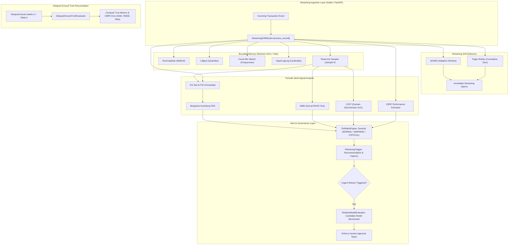

# Label-Free Streaming Drift Monitor with Bounded-Memory Sketches and Automated Retrain Triggers

An enterprise-grade, memory-bounded machine learning monitoring system designed to detect continuous distribution drift, estimate model degradation without ground-truth labels, and govern model retraining in real-time streaming environments.

> 📖 **Comprehensive Repository Index & Architecture Catalog**: See [INDEX.md](INDEX.md) for a complete, structured catalog of all mathematical formulas, bounded sketches, drift detection algorithms, 14 REST API endpoints, database schemas, and all 36 automated unit & integration test cases.

---

## 1. Project Overview

In production machine learning systems, real-world data distributions inevitably evolve over time (covariate shift, concept drift, seasonal shifts). However, true ground-truth labels are frequently delayed by days, weeks, or months (e.g. fraud confirmation, credit default, customer churn). Traditional monitoring systems that rely on confirmed labels cannot detect degradation in real time, while naive sliding windows incur unbounded memory consumption.

This project addresses these challenges through:
1. **Label-Free Continuous Drift Detection**: Monitors feature distributions and prediction confidences in streaming data without waiting for ground-truth labels.
2. **Bounded-Memory Streaming Sketches**: Replaces raw memory windows with compact statistical summaries (t-digest, Count-Min Sketch, HyperLogLog, Welford's algorithm).
3. **Confidence-Based Performance Estimation (CBPE)**: Mathematically estimates Accuracy, F1-score, Precision, Recall, and ROC-AUC from calibrated prediction confidences under the Covariate Shift assumption.
4. **Governed Retraining Triggers & Shadow Model Evaluation**: Combines multi-signal drift evidence to issue severity-based alerts (`NORMAL`, `WARNING`, `CRITICAL`), train candidate shadow models, and benchmark against active production models before promotion.

---

## 2. Architecture & Data Flow



---

## 3. Unified Project Components & Contributors

This repository integrates both the **ML & Statistical Monitoring Engine** (`ml_engine/`) and the **Streaming Backend, API, Dashboard & Governance Layer** (`backend/`) into a single cohesive platform launched via [`main.py`](main.py).

| Contributor | Role | Primary Subsystems | Status |
| :--- | :--- | :--- | :---: |
| **Hiral** (`Hiral07-og`) | ML & Statistical Monitoring Lead | Bounded-memory sketches, streaming & multivariate drift detectors, CBPE, shadow model evaluator, benchmark suite | **100% Complete** |
| **Laxmi Singla** (`BuildsByLaxmi`) | Streaming Systems & Backend Lead | Kafka/Redpanda producer & consumer, FastAPI REST APIs, SQLite audit store, interactive web dashboard, Prometheus & Docker | **100% Complete** |

### Integrated System Capabilities
- [x] **Calibrated ML Baseline & Reference Engine**: Temporal fraud benchmark (`StreamingFinancialBenchmark`) + Elliptic Bitcoin loader with Platt/Sigmoid probability calibration.
- [x] **5 Bounded-Memory Streaming Sketches**: Welford `RunningStats`, `TDigest` ($0.36\%$ mean quantile error), `CountMinSketch` with conservative update, `HyperLogLog` ($0.24\%$ cardinality error), and fixed-capacity `ReservoirSampler` — all live-monitored in the API and dashboard.
- [x] **Multi-Signal Drift Detection**: Streaming univariate detectors (`ADWIN`, `PageHinkley`), windowed distribution tests (`KS-Test`, `PSI`) with Benjamini-Hochberg FDR multiple-testing correction, and multivariate detectors (`MMD` with Gaussian RBF kernel & `C2ST` discriminator AUC).
- [x] **Label-Free Performance Estimation (CBPE) & Delayed Reconciliation**: Estimates Accuracy, Precision, Recall, F1, and ROC-AUC from calibrated confidences without labels, and tracks continuous estimation error when delayed ground-truth labels arrive.
- [x] **Governed Retraining & Shadow Evaluation**: Severity-based alerting (`NORMAL`, `WARNING`, `CRITICAL`), retraining urgency triggers with guardrails, shadow candidate evaluation, and cryptographic approval token verification logged in SQLite.
- [x] **Unified Streaming Backend & Live Dashboard**: Kafka/Redpanda + zero-dependency in-memory Producer/Consumer pipeline, 19 FastAPI endpoints across 6 routers (including live controlled drift simulation for all 5 drift regimes and live benchmark execution), interactive dark-mode Chart.js Web Dashboard, Prometheus `/metrics` exporter, and Docker Compose orchestration.

---

## 4. Experimental Benchmark Results

Quantitative evaluation conducted on synthetic temporal financial transaction streams ($2,500$ reference records, $5,000$ streaming records):

### Detection Delay Across Controlled Drift Types
| Drift Type | Injection Index | Detection Index | Delay (Records) | Detection Status | Alert Severity |
| :--- | :---: | :---: | :---: | :---: | :---: |
| **Abrupt Drift** | 600 | 605 | **5 records** | DETECTED | `CRITICAL` |
| **Gradual Drift** | 600 | 600 | **0 records** | DETECTED | `CRITICAL` |
| **Recurring Drift** | 150 | 150 | **0 records** | DETECTED | `CRITICAL` |
| **Feature-Specific Drift** | 600 | 600 | **0 records** | DETECTED | `CRITICAL` |

### Sketch Quantile Accuracy (t-digest vs Exact NumPy Percentiles)
| Quantile | Exact Value | t-digest Approx | Relative Error |
| :---: | :---: | :---: | :---: |
| **p01** | \$5.92 | \$5.91 | 0.25% |
| **p05** | \$12.34 | \$12.33 | 0.10% |
| **p10** | \$17.37 | \$17.39 | 0.13% |
| **p50 (Median)** | \$64.22 | \$64.23 | **0.01%** |
| **p90** | \$239.34 | \$239.50 | 0.07% |
| **p95** | \$343.63 | \$343.26 | 0.11% |
| **p99** | \$658.50 | \$673.86 | 2.33% |
- **Mean Relative Error Across Quantiles**: **0.36%**
- **HyperLogLog Cardinality Error**: **0.24%**

### Label-Free Performance Estimation Accuracy (CBPE vs Delayed Ground Truth)
| Metric | CBPE Label-Free Estimate | Actual Delayed Ground Truth | Absolute Error (MAE) |
| :--- | :---: | :---: | :---: |
| **Accuracy** | 90.46% | 91.50% | **0.0104 (1.04%)** |
| **F1-Score** | 24.62% | 29.17% | **0.0454 (4.54%)** |
| **ROC-AUC** | 0.7895 | 0.8838 | **0.0943** |
| **Brier Score** | 0.0764 | 0.0651 | **0.0113** |

---

## 5. Repository Structure

```
label-free-streaming-drift-monitor/
├── ml_engine/
│   ├── __init__.py
│   ├── drift_monitor/
│   │   ├── __init__.py                # Clean top-level package exports
│   │   ├── config.py                  # Strongly typed configuration dataclasses
│   │   ├── dataset.py                 # Streaming temporal transaction generator & Elliptic loader
│   │   ├── model.py                   # Baseline ML model with probability calibration
│   │   ├── monitor.py                 # Unified StreamingDriftMonitor orchestrator
│   │   ├── PERSON2_INTEGRATION_GUIDE.md # Kafka and FastAPI integration contracts
│   │   ├── sketches/                  # Bounded-memory streaming sketches
│   │   │   ├── running_stats.py       # Welford accumulator (O(1))
│   │   │   ├── tdigest.py             # t-digest approximate quantile sketch
│   │   │   ├── count_min_sketch.py    # Count-Min Sketch with conservative update
│   │   │   ├── hyperloglog.py         # HyperLogLog cardinality estimator
│   │   │   └── reservoir.py           # Fixed-capacity Reservoir Sampler
│   │   ├── detectors/                 # Univariate and multivariate drift detectors
│   │   │   ├── adwin.py               # Adaptive Windowing streaming detector
│   │   │   ├── page_hinkley.py        # Page-Hinkley sequential change detector
│   │   │   ├── distribution_tests.py  # KS-test & Population Stability Index (PSI)
│   │   │   ├── mmd.py                 # Maximum Mean Discrepancy (Gaussian RBF)
│   │   │   ├── c2st.py                # Classifier Two-Sample Test (Domain AUC)
│   │   │   └── corrections.py         # Benjamini-Hochberg FDR & Bonferroni
│   │   ├── performance_estimation/    # Label-free performance estimation
│   │   │   ├── cbpe.py                # Confidence-Based Performance Estimation
│   │   │   └── delayed_evaluator.py   # Delayed ground-truth error tracking
│   │   ├── retraining/                # Alerting & automated retraining governance
│   │   │   ├── alert_engine.py        # Multi-signal severity classification
│   │   │   ├── retrain_trigger.py     # Retraining recommendation generator
│   │   │   └── shadow_evaluator.py    # Candidate shadow-model benchmark
│   │   └── benchmarks/                # Controlled drift experiments & reports
│   │       ├── drift_generator.py     # Injects abrupt, gradual, recurring, feature drift
│   │       ├── run_benchmarks.py      # Automated benchmark execution suite
│   │       ├── generate_report.py     # Generates Markdown and CSV reports
│   │       └── reports/               # Output benchmark tables and reports
│   └── tests/                         # Comprehensive unit & integration test suite
│       ├── test_sketches.py           # Unit tests for bounded sketches
│       ├── test_detectors.py          # Unit tests for ADWIN, PH, KS, MMD, C2ST
│       ├── test_cbpe.py               # Unit tests for CBPE expectations & errors
│       ├── test_retraining.py         # Unit tests for alert engine & shadow model
│       └── test_streaming_monitor.py  # Integration tests for StreamingDriftMonitor
├── backend/                           # Streaming Backend, API, Dashboard & Governance
│   ├── app/
│   │   ├── config.py                  # Server, Kafka, and storage configuration
│   │   ├── main.py                    # FastAPI application, CORS, lifespan & Prometheus exporter
│   │   ├── schemas/                   # Pydantic schemas (events, drift, performance, alerts)
│   │   ├── storage/                   # Thread-safe SQLite database manager
│   │   ├── services/                  # Unified DriftService & AlertService
│   │   ├── streaming/                 # Kafka/in-memory producer, consumer & simulator
│   │   ├── routers/                   # API routers (stream, drift, performance, alerts, retrain, benchmarks)
│   │   └── dashboard/static/          # Interactive Web Dashboard (index.html, styles.css, app.js)
│   ├── tests/                         # Backend test suite (17 tests)
│   └── requirements.txt               # Backend dependencies
├── tests/
│   └── test_e2e_integration.py        # Unified End-to-End integration tests (5 tests)
├── main.py                            # Unified Master CLI (serve, demo, benchmark, test)
├── Dockerfile                         # Multi-stage production container image
├── docker-compose.yml                 # Orchestration (Backend, Redpanda Kafka, Prometheus, Grafana)
├── prometheus.yml                     # Prometheus scrape configuration
├── run_person1_demo.py                # ML engine standalone demonstration
├── run_person2_backend_demo.py        # Backend standalone demonstration
├── requirements.txt                   # Unified project dependencies
├── INDEX.md                           # Complete repository index & catalog
└── README.md                          # Project documentation
```

---

## 6. Quickstart Guide (One-Command Unified Workflow)

### 1. Installation
```bash
git clone https://github.com/Hiral07-og/label-free-streaming-drift-monitor.git
cd label-free-streaming-drift-monitor

python -m venv .venv
# On Windows:
.venv\Scripts\activate
# On Linux/macOS:
# source .venv/bin/activate

pip install -r requirements.txt
```

### 2. Run the Complete Unified Test Suite (41 Tests, 100% Passing)
```bash
python main.py test
```

### 3. Run the Unified End-to-End System Showcase
```bash
python main.py demo
```

### 4. Launch the Unified Server & Interactive Web Dashboard
```bash
# Start server on standby (trigger scenarios from the UI):
python main.py serve

# Or launch with continuous live streaming enabled automatically:
python main.py serve --auto-stream --rate 5
```
Open your browser to:
- **Interactive Web Dashboard**: [http://localhost:8000/dashboard](http://localhost:8000/dashboard)
- **Interactive Swagger API Docs**: [http://localhost:8000/docs](http://localhost:8000/docs)
- **Prometheus Metrics Exporter**: [http://localhost:8000/metrics](http://localhost:8000/metrics)

### 5. Run the Controlled Experimental Benchmark Suite
```bash
python main.py benchmark
```

### 6. Launch Full Cloud-Ready Stack with Docker Compose
```bash
docker-compose up -d
```
Services available:
- **Unified App & Dashboard**: [http://localhost:8000](http://localhost:8000)
- **Prometheus Metrics**: [http://localhost:9090](http://localhost:9090)
- **Grafana Dashboards**: [http://localhost:3000](http://localhost:3000) (`admin` / `admin`)
- **Redpanda Streaming Broker**: `localhost:9092`
