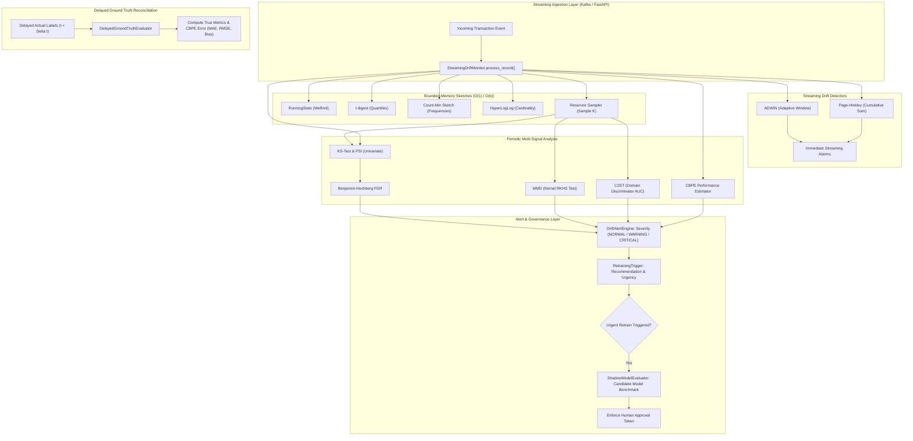

# Label-Free Streaming Drift Monitor with Bounded-Memory Sketches and Automated Retrain Triggers

An enterprise-grade, memory-bounded machine learning monitoring system designed to detect continuous distribution drift, estimate model degradation without ground-truth labels, and govern model retraining in real-time streaming environments.

---

## 1. Project Overview

In production machine learning systems, real-world data distributions inevitably evolve over time (covariate shift, concept drift, seasonal shifts). However, true ground-truth labels are frequently delayed by days, weeks, or months (e.g. fraud confirmation, credit default, customer churn). Traditional monitoring systems that rely on confirmed labels cannot detect degradation in real time, while naive sliding windows incur unbounded memory consumption.

This project addresses these challenges through:
1. **Label-Free Continuous Drift Detection**: Monitors feature distributions and prediction confidences in streaming data without waiting for ground-truth labels.
2. **Bounded-Memory Streaming Sketches**: Replaces raw memory windows with compact statistical summaries (t-digest, Count-Min Sketch, HyperLogLog, Welford's algorithm).
3. **Confidence-Based Performance Estimation (CBPE)**: Mathematically estimates Accuracy, F1-score, Precision, Recall, and ROC-AUC from calibrated prediction confidences under the Covariate Shift assumption.
4. **Governed Retraining Triggers & Shadow Model Evaluation**: Combines multi-signal drift evidence to issue severity-based alerts (`NORMAL`, `WARNING`, `CRITICAL`), train candidate shadow models, and benchmark against active production models before promotion.

---

## 2. Architecture & Data Flow



---

## 3. Team Responsibilities & Project Roadmap

| Role | Lead | Focus Area | Deliverable Status |
| :--- | :--- | :--- | :---: |
| **Person 1** | **ML & Statistical Monitoring Lead** | Mathematical core, bounded sketches, drift engines, CBPE, benchmarks | **100% Complete** |
| **Person 2** | **Backend & Systems Lead** | Kafka streaming pipeline, FastAPI endpoints, Prometheus/Grafana, Docker | In Progress |

### Person 1 Deliverables Summary (Weeks 1 – 8)
- [x] **Week 1**: Selected temporal fraud benchmark (`StreamingFinancialBenchmark`), trained Gradient Boosting model with Platt/Sigmoid probability calibration.
- [x] **Week 2**: Implemented bounded sketches: Welford `RunningStats`, `TDigest` ($0.36\%$ mean quantile error), `CountMinSketch` with conservative update, `HyperLogLog` ($0.24\%$ error), and `ReservoirSampler`.
- [x] **Week 3**: Implemented streaming univariate detectors: `ADWIN` and `PageHinkley`, alongside two-sample Kolmogorov-Smirnov (KS) and Population Stability Index (PSI).
- [x] **Week 4**: Implemented multivariate drift detectors: Maximum Mean Discrepancy (`MMD`) with RBF kernel and Classifier Two-Sample Test (`C2ST`), with Benjamini-Hochberg FDR multiple testing correction.
- [x] **Week 5**: Implemented Confidence-Based Performance Estimation (`CBPE`) and `DelayedGroundTruthEvaluator` ($1.04\%$ Accuracy MAE).
- [x] **Week 6**: Implemented `DriftAlertEngine` (Severity levels), `RetrainingTrigger`, and `ShadowModelEvaluator` with governance approval tokens.
- [x] **Week 7**: Engineered unified master `StreamingDriftMonitor` and authored `PERSON2_INTEGRATION_GUIDE.md`.
- [x] **Week 8**: Built synthetic drift benchmark suite (`drift_generator.py`, `run_benchmarks.py`) generating CSV and Markdown reports across all scenarios.

---

## 4. Experimental Benchmark Results

Quantitative evaluation conducted on synthetic temporal financial transaction streams ($2,500$ reference records, $5,000$ streaming records):

### Detection Delay Across Controlled Drift Types
| Drift Type | Injection Index | Detection Index | Delay (Records) | Detection Status | Alert Severity |
| :--- | :---: | :---: | :---: | :---: | :---: |
| **Abrupt Drift** | 600 | 605 | **5 records** | DETECTED | `CRITICAL` |
| **Gradual Drift** | 600 | 600 | **0 records** | DETECTED | `CRITICAL` |
| **Recurring Drift** | 150 | 150 | **0 records** | DETECTED | `CRITICAL` |
| **Feature-Specific Drift** | 600 | 600 | **0 records** | DETECTED | `CRITICAL` |

### Sketch Quantile Accuracy (t-digest vs Exact NumPy Percentiles)
| Quantile | Exact Value | t-digest Approx | Relative Error |
| :---: | :---: | :---: | :---: |
| **p01** | \$5.92 | \$5.91 | 0.25% |
| **p05** | \$12.34 | \$12.33 | 0.10% |
| **p10** | \$17.37 | \$17.39 | 0.13% |
| **p50 (Median)** | \$64.22 | \$64.23 | **0.01%** |
| **p90** | \$239.34 | \$239.50 | 0.07% |
| **p95** | \$343.63 | \$343.26 | 0.11% |
| **p99** | \$658.50 | \$673.86 | 2.33% |
- **Mean Relative Error Across Quantiles**: **0.36%**
- **HyperLogLog Cardinality Error**: **0.24%**

### Label-Free Performance Estimation Accuracy (CBPE vs Delayed Ground Truth)
| Metric | CBPE Label-Free Estimate | Actual Delayed Ground Truth | Absolute Error (MAE) |
| :--- | :---: | :---: | :---: |
| **Accuracy** | 90.46% | 91.50% | **0.0104 (1.04%)** |
| **F1-Score** | 24.62% | 29.17% | **0.0454 (4.54%)** |
| **ROC-AUC** | 0.7895 | 0.8838 | **0.0943** |
| **Brier Score** | 0.0764 | 0.0651 | **0.0113** |

---

## 5. Repository Structure

```
label-free-streaming-drift-monitor/
├── ml_engine/
│   ├── __init__.py
│   ├── drift_monitor/
│   │   ├── __init__.py                # Clean top-level package exports
│   │   ├── config.py                  # Strongly typed configuration dataclasses
│   │   ├── dataset.py                 # Streaming temporal transaction generator & Elliptic loader
│   │   ├── model.py                   # Baseline ML model with probability calibration
│   │   ├── monitor.py                 # Unified StreamingDriftMonitor orchestrator
│   │   ├── PERSON2_INTEGRATION_GUIDE.md # Kafka and FastAPI integration contracts
│   │   ├── sketches/                  # Bounded-memory streaming sketches
│   │   │   ├── running_stats.py       # Welford accumulator (O(1))
│   │   │   ├── tdigest.py             # t-digest approximate quantile sketch
│   │   │   ├── count_min_sketch.py    # Count-Min Sketch with conservative update
│   │   │   ├── hyperloglog.py         # HyperLogLog cardinality estimator
│   │   │   └── reservoir.py           # Fixed-capacity Reservoir Sampler
│   │   ├── detectors/                 # Univariate and multivariate drift detectors
│   │   │   ├── adwin.py               # Adaptive Windowing streaming detector
│   │   │   ├── page_hinkley.py        # Page-Hinkley sequential change detector
│   │   │   ├── distribution_tests.py  # KS-test & Population Stability Index (PSI)
│   │   │   ├── mmd.py                 # Maximum Mean Discrepancy (Gaussian RBF)
│   │   │   ├── c2st.py                # Classifier Two-Sample Test (Domain AUC)
│   │   │   └── corrections.py         # Benjamini-Hochberg FDR & Bonferroni
│   │   ├── performance_estimation/    # Label-free performance estimation
│   │   │   ├── cbpe.py                # Confidence-Based Performance Estimation
│   │   │   └── delayed_evaluator.py   # Delayed ground-truth error tracking
│   │   ├── retraining/                # Alerting & automated retraining governance
│   │   │   ├── alert_engine.py        # Multi-signal severity classification
│   │   │   ├── retrain_trigger.py     # Retraining recommendation generator
│   │   │   └── shadow_evaluator.py    # Candidate shadow-model benchmark
│   │   └── benchmarks/                # Controlled drift experiments & reports
│   │       ├── drift_generator.py     # Injects abrupt, gradual, recurring, feature drift
│   │       ├── run_benchmarks.py      # Automated benchmark execution suite
│   │       ├── generate_report.py     # Generates Markdown and CSV reports
│   │       └── reports/               # Output benchmark tables and reports
│   └── tests/                         # Comprehensive unit & integration test suite
│       ├── test_sketches.py           # Unit tests for bounded sketches
│       ├── test_detectors.py          # Unit tests for ADWIN, PH, KS, MMD, C2ST
│       ├── test_cbpe.py               # Unit tests for CBPE expectations & errors
│       ├── test_retraining.py         # Unit tests for alert engine & shadow model
│       └── test_streaming_monitor.py  # Integration tests for StreamingDriftMonitor
├── run_person1_demo.py                # Complete turn-by-turn demonstration script
├── requirements.txt                   # Production dependencies
└── README.md                          # Project documentation
```

---

## 6. Quickstart Guide

### 1. Installation
```bash
git clone https://github.com/Hiral07-og/label-free-streaming-drift-monitor.git
cd label-free-streaming-drift-monitor

python -m venv .venv
# On Windows:
.venv\Scripts\activate
# On Linux/macOS:
# source .venv/bin/activate

pip install -r requirements.txt
```

### 2. Run All Unit Tests
```bash
python -m unittest discover ml_engine/tests/
```

### 3. Run the Live End-to-End Showcase
```bash
python run_person1_demo.py
```

### 4. Integration for Person 2 (Backend / Systems Lead)
See [PERSON2_INTEGRATION_GUIDE.md](ml_engine/drift_monitor/PERSON2_INTEGRATION_GUIDE.md) for Kafka consumer integration patterns, FastAPI endpoint implementations (`GET /drift/status`, `POST /stream/record`), and Prometheus exporter mappings.
